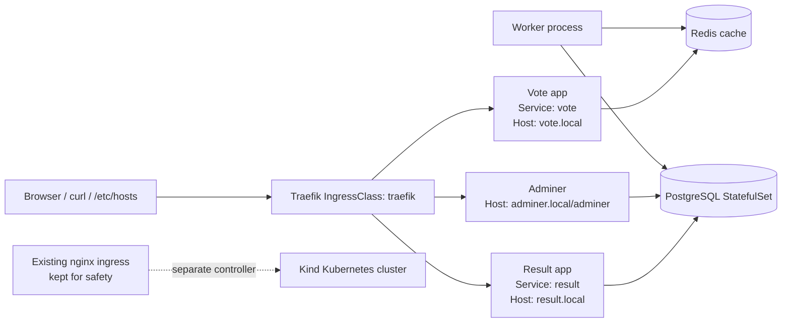

# Assignment 2 – Kubernetes app deployment and ingress setup

This README explains the full assignment from the beginning, step by step, with the exact commands used and the reason for each action. The goal was to deploy a small voting application in Kubernetes, keep the existing cluster working, add Traefik without breaking nginx, and make the app reachable through local hostnames.

---

## 1. Objective of the assignment

The target application has these parts:
- Vote app
- Result app
- PostgreSQL database
- Redis cache
- Worker service
- Adminer UI
- Ingress routes for vote.local, result.local, adminer.local
- Resource quota, HPA, network policies, priority classes, PDBs, and backup logic

The assignment also required careful attention to:
- not removing an already working ingress controller
- adding Traefik safely as a second controller
- checking local DNS in /etc/hosts
- fixing local port conflicts caused by Docker listeners on 80 and 443
- validating access from the browser and with curl

---

## 2. Project plan

The work was broken into a controlled sequence so the cluster stayed stable while the application was deployed:

1. Inspect the existing cluster and confirm the active ingress setup.
2. Keep the current nginx ingress in place and add Traefik as a second ingress controller.
3. Create the application namespace and required policies, quotas, and RBAC objects.
4. Deploy the data layer: PostgreSQL and Redis.
5. Deploy the frontend, backend, worker, and Adminer workloads.
6. Configure ingress routes for the local hostnames.
7. Run connectivity and health checks for networking, DNS, TLS, autoscaling, and storage.
8. Validate the final application from browser and CLI tools.

---

## 3. Professional Helm delivery roadmap

The next step is to package the assignment as a professional Helm deployment using a single umbrella release and clean subchart boundaries.

### Target design

We will create one Helm chart in a dedicated directory, for example:

```text
helm/
└── assign2/
    ├── Chart.yaml
    ├── values.yaml
    ├── templates/
    │   ├── namespace.yaml
    │   ├── certificates.yaml
    │   └── NOTES.txt
    ├── charts/
    │   ├── data/
    │   │   ├── Chart.yaml
    │   │   └── values.yaml
    │   ├── app/
    │   │   ├── Chart.yaml
    │   │   └── values.yaml
    │   ├── ingress/
    │   │   ├── Chart.yaml
    │   │   └── values.yaml
    │   └── security/
    │       ├── Chart.yaml
    │       └── values.yaml
    └── README.md
```

### Recommended subchart structure

- `data`: PostgreSQL and Redis
- `app`: Vote, Result, Worker, and Adminer
- `ingress`: Traefik + Ingress + TLS resources
- `security`: NetworkPolicies, RBAC, Quotas, PDBs, HPA, priority classes

This keeps a single release, but cleanly separates responsibilities and follows Helm best practices.

### Best-practice rules for the chart

- Use one umbrella chart as the top-level release.
- Keep `Chart.yaml` dependencies explicit for each subchart.
- Use `values.yaml` at the root for shared values and global overrides.
- Use `{{ .Release.Namespace }}` instead of hard-coded namespaces.
- Keep names deterministic and release-aware.
- Put global configuration under `global:`.
- Use `condition: enabled` or `tags` for optional components.
- Avoid mixing logic for DB, app, ingress, and security in one template file.
- Use `helm dependency update` before install.

### Planned release flow

1. Create the Helm chart folder and chart metadata.
2. Add subcharts and chart dependencies.
3. Define shared values for namespace, hostnames, TLS, and app settings.
4. Add the namespace template and install into a dedicated namespace.
5. Configure PostgreSQL, Redis, app workloads, ingress, and TLS with release-scoped names.
6. Add quota, HPA, priority, PDB, and network policy logic.
7. Validate with `helm lint`, `helm template`, and `helm upgrade --install`.
8. Confirm application access using `curl` and hostname checks.

### Planned install command

```bash
helm dependency update ./helm/assign2
helm upgrade --install assign2 ./helm/assign2 \
  --namespace assign2 \
  --create-namespace
```

This approach is the professional model for a multi-component app: one release, clear dependency boundaries, reproducible deployment, and easier upgrades.

---

## 4. Architecture overview



Simple architecture view:

```text
Browser / curl / /etc/hosts
             |
             v
      Traefik (IngressClass: traefik)
        /        |        \
       /         |         \
  vote.local  result.local  adminer.local
       |           |             |
       v           v             v
     vote svc    result svc     adminer
       |           |             |
       +----> Redis <----+       |
                    \           |
                     \          v
                     +----> PostgreSQL

Worker --> Redis
Worker --> PostgreSQL

Existing nginx remains active as a separate ingress controller in the cluster.
```

### Traffic flow
- Users access the app through Traefik on local hostnames.
- `vote.local` sends traffic to the Vote service.
- `result.local` sends traffic to the Result service.
- `adminer.local` is routed to the Adminer dashboard.
- The Vote and Result apps are isolated by network policies.
- The Worker app reads from Redis and writes to PostgreSQL.

---

## 4. Test plan and validation checklist

The assignment was not complete until both functional and network validation succeeded.

### Application readiness checks

```bash
kubectl get ns
kubectl get pods -A
kubectl get all -n traefik
kubectl get all -n assign2
kubectl get ingress -n assign2
kubectl get ingressclass -A
```

### Network and DNS checks

```bash
kubectl -n assign2 run vote-redis-check --rm -it --restart=Never --image=busybox:1.36 --labels=app=vote -- sh -c 'nc -vz redis 6379'
kubectl -n assign2 run worker-db-check --rm -it --restart=Never --image=busybox:1.36 --labels=app=worker -- sh -c 'nc -vz db 5432'
kubectl -n assign2 run dns-egress-check --rm -it --restart=Never --image=busybox:1.36 --labels=app=vote -- sh -c 'nslookup kubernetes.default.svc.cluster.local'
```

### Ingress and TLS checks

```bash
curl -vk https://vote.local --resolve vote.local:443:127.0.0.1
curl -vk https://result.local --resolve result.local:443:127.0.0.1
curl -vk https://adminer.local --resolve adminer.local:443:127.0.0.1
kubectl get secret -n assign2 assign2-tls
kubectl describe secret -n assign2 assign2-tls
```

### Security and resilience checks

```bash
kubectl get networkpolicy -n assign2 -o wide
kubectl get hpa -n assign2
kubectl get pdb -n assign2
kubectl get quota -n assign2
kubectl get pvc -n assign2
```

### Backup validation

```bash
kubectl -n assign2 get pods -l app=postgres-backup
kubectl -n assign2 exec <pod-name> -- ls -l /backup
kubectl exec -it postgres-restore -- psql -U postgres -d postgres -c 'SELECT count(*) FROM votes;'
```

These checks confirm that the application is reachable, database and cache access is allowed only as intended, ingress is routing correctly, and the platform remains resilient and secure.

---

## 5. Starting point: check the cluster before changing anything

The first step was to understand what already existed in the cluster.

Commands used:

```bash
kubectl get ns
kubectl get nodes -o wide
kubectl get ingressclass -A
kubectl get pods -A | grep -Ei 'traefik|ingress'
kubectl get svc -n ingress-nginx
```

What we found:
- ingress-nginx was already installed
- IngressClass `nginx` existed
- the cluster was already using nginx for ingress
- Traefik was not installed yet

This was the key root fact. The cluster was not empty, and the existing nginx setup was already working.

### Why this mattered
If we deleted nginx, we could break the current cluster. The safe option was to keep nginx and add Traefik separately as a second ingress controller.

---

## 6. The main design decision: keep nginx and add Traefik

The safe architecture was:
- leave the already working nginx ingress alone
- install Traefik in namespace `traefik`
- create a separate IngressClass named `traefik`
- point the assignment app at Traefik using `ingressClassName: traefik`

This avoids conflict and keeps the cluster stable.

### Commands used to inspect the existing ingress controller

```bash
kubectl get ingressclass nginx -o yaml
kubectl describe ingressclass nginx
kubectl get svc -n ingress-nginx
```

This confirmed:
- nginx existed as a valid controller
- it was already active and functioning
- we should not replace it blindly

---

## 7. Add Traefik as a second controller

Because the project uses Kind, Helm is the easiest and cleanest method.

### Commands used

```bash
helm repo add traefik https://traefik.github.io/charts
helm repo update
kubectl create namespace traefik
```

Then the installation command was adjusted to the correct Traefik v3 values format.

### Correct Helm values used

```yaml
ingressClass:
  enabled: true
  isDefaultClass: false
  name: traefik

service:
  type: NodePort

ports:
  web:
    port: 80
    expose:
      default: true
    exposedPort: 80
    nodePort: 30080
  websecure:
    port: 443
    expose:
      default: true
    exposedPort: 443
    nodePort: 30443
```

Install command:

```bash
helm install traefik traefik/traefik --namespace traefik --create-namespace -f values.yaml
```

### Why the first install had issues
The problem was that the values file had the wrong schema for Traefik chart version in use. The ports section must follow the chart’s actual structure. Once corrected, installation succeeded.

---

## 8. Verify Traefik is healthy

After installation, we checked the resources.

### Commands used

```bash
kubectl get all -n traefik
kubectl get ingressclass -A
kubectl wait --for=condition=Ready pod -n traefik -l app.kubernetes.io/name=traefik --timeout=180s
```

What we confirmed:
- Traefik pod was Ready
- IngressClass `traefik` existed
- Traefik controller was `traefik.io/ingress-controller`

The service was exposing NodePorts:
- 80 -> 30080
- 443 -> 30443

This proved that the second ingress controller was working and isolated from nginx.

---

## 9. Create the application namespace and core resources

The app resources were placed under namespace `assign2`.

### Commands used

```bash
kubectl apply -f namespace.yaml
kubectl apply -f configmaps.yaml
kubectl apply -f secrets.yaml
kubectl apply -f quota.yaml
kubectl apply -f rbac.yaml
kubectl apply -f priority.yaml
kubectl apply -f networkpolicies.yaml
kubectl apply -f pdb.yaml
kubectl apply -f hpa.yaml
kubectl apply -f backup.yaml
```

### Files used
- `assign2-manifests/namespace.yaml`
- `assign2-manifests/configmaps.yaml`
- `assign2-manifests/secrets.yaml`
- `assign2-manifests/quota.yaml`
- `assign2-manifests/rbac.yaml`
- `assign2-manifests/priority.yaml`
- `assign2-manifests/networkpolicies.yaml`
- `assign2-manifests/pdb.yaml`
- `assign2-manifests/hpa.yaml`
- `assign2-manifests/backup.yaml`

### Why these were needed
These resources provide:
- dedicated namespace for the app
- config for Redis/PostgreSQL
- secure credentials
- resource limits and quota enforcement
- RBAC setup and policies
- pod priority to keep critical services scheduled
- HPA for autoscaling
- backup and restore support

---

## 10. Deploy the database and cache

### PostgreSQL

The database is a StatefulSet with a headless Service and a PVC template.

#### Commands used

```bash
kubectl apply -f postgres-statefulset.yaml
kubectl get pods -n assign2
kubectl get pvc -n assign2
kubectl get svc -n assign2
```

### Problems we saw
At one point, PostgreSQL had PVC waiting or scheduling issues. Root cause was not the storage itself, but resource constraints and scheduling state. After fixing priority and quota values, the StatefulSet bound the PVC successfully.

### Redis

```bash
kubectl apply -f redis.yaml
kubectl get deploy -n assign2
kubectl get pods -n assign2
```

This deployed the Redis service and pod properly.

---

## 11. Deploy the application services

### Vote app

```bash
kubectl apply -f vote.yaml
kubectl get svc -n assign2 vote
kubectl get pods -n assign2 -l app=vote
```

### Result app

```bash
kubectl apply -f result.yaml
kubectl get svc -n assign2 result
kubectl get pods -n assign2 -l app=result
```

### Worker and Adminer

```bash
kubectl apply -f worker-adminer.yaml
kubectl get pods -n assign2
kubectl get svc -n assign2 adminer
```

### Why the worker had initContainer issues
The worker depended on Redis and PostgreSQL being reachable before it started. We used initContainers to wait for DB and Redis and avoid startup race conditions.

Example idea used:

```yaml
initContainers:
- name: wait-for-db
  image: busybox:1.36
  command: ["sh", "-c", "until nc -z db 5432; do echo waiting for db; sleep 2; done"]
- name: wait-for-redis
  image: busybox:1.36
  command: ["sh", "-c", "until nc -z redis 6379; do echo waiting for redis; sleep 2; done"]
```

This avoids worker startup before dependencies are ready.

---

## 12. Expose the app through Traefik ingress

The ingress manifest was created in the assignment namespace.

### Commands used

```bash
kubectl apply -f ingress.yaml
kubectl get ingress -n assign2
kubectl describe ingress -n assign2 assign2-traefik
```

### Ingress definition used

```yaml
apiVersion: networking.k8s.io/v1
kind: Ingress
metadata:
  name: assign2-traefik
  namespace: assign2
  annotations:
    traefik.ingress.kubernetes.io/router.entrypoints: web,websecure
    traefik.ingress.kubernetes.io/redirect-scheme: https
    traefik.ingress.kubernetes.io/redirect-permanent: "true"
spec:
  ingressClassName: traefik
  rules:
    - host: vote.local
      http:
        paths:
          - path: /
            pathType: Prefix
            backend:
              service:
                name: vote
                port:
                  number: 80
    - host: result.local
      http:
        paths:
          - path: /
            pathType: Prefix
            backend:
              service:
                name: result
                port:
                  number: 80
    - host: adminer.local
      http:
        paths:
          - path: /adminer
            pathType: Prefix
            backend:
              service:
                name: adminer
                port:
                  number: 8080
  tls:
    - hosts:
        - vote.local
        - result.local
        - adminer.local
      secretName: assign2-tls
```

This routes traffic based on the hostname and uses Traefik.

---

## 13. Add TLS secret for HTTPS

The Ingress requires a TLS secret named `assign2-tls`.

### Commands used

```bash
openssl req -x509 -nodes -days 365 -newkey rsa:2048 \
  -keyout tls.key -out tls.crt \
  -subj "/CN=vote.local/O=assign2" \
  -addext "subjectAltName=DNS:vote.local,DNS:result.local,DNS:adminer.local"

kubectl -n assign2 create secret tls assign2-tls --key tls.key --cert tls.crt
```

This creates a self-signed certificate so HTTPS works locally for the project.

---

## 14. Check /etc/hosts for local DNS

The browser needs the hostnames to resolve locally.

### Commands used

```bash
cat /etc/hosts
getent hosts vote.local result.local adminer.local
```

The correct entry should be:

```bash
127.0.0.1 vote.local result.local adminer.local
```

### Why this matters
Your browser does not automatically know `vote.local` unless your machine resolves it from `/etc/hosts`.

If the entry is missing, DNS fails even if the Kubernetes route exists.

### Fix command used

```bash
sudo bash -c 'echo "127.0.0.1 vote.local result.local adminer.local" >> /etc/hosts'
```

This ensures the hostnames resolve on your local machine.

---

## 15. Access the app locally

The app is not reachable on port 80/443 because Docker is already using those ports on the machine.

### Commands used to verify the port conflict

```bash
sudo ss -lntp '( sport = :80 or sport = :443 )'
```

This showed:
- docker-proxy listening on 80 and 443

### Why this caused a problem
The browser was reaching the local Docker default site on port 443 instead of the Kubernetes Traefik ingress. That produced a 404 page from nginx.

That is why we used the port-forward to expose the Traefik service on a different local port.

### Correct forwarding command

```bash
kubectl -n traefik port-forward svc/traefik 8443:443 8080:80 --address 0.0.0.0
```

Then the browser can access:
- https://vote.local:8443
- https://result.local:8443
- https://adminer.local:8443/adminer

### Verification with curl

```bash
curl -k -I --resolve vote.local:8443:127.0.0.1 https://vote.local:8443/
curl -k -I --resolve result.local:8443:127.0.0.1 https://result.local:8443/
curl -k -I --resolve adminer.local:8443:127.0.0.1 https://adminer.local:8443/adminer
```

These returned HTTP 200, which confirmed the application was reachable and healthy.

---

## 16. The main troubleshooting issues we fixed

### Issue 1: nginx already existed and had to remain
**Fix:** kept nginx untouched and installed Traefik separately.

### Issue 2: Traefik install values were wrong
**Fix:** corrected Helm chart values to match the chart schema.

### Issue 3: PostgreSQL PVC was stuck or not scheduled properly
**Fix:** corrected resource and scheduling constraints, then re-applied the StatefulSet.

### Issue 4: worker started before Redis/Postgres became ready
**Fix:** used initContainers with `nc -z` checks.

### Issue 5: local DNS hostnames were missing
**Fix:** added entries to /etc/hosts.

### Issue 6: Docker already listening on 80/443
**Fix:** used Traefik port-forward on 8443 and 8080.

### Issue 7: port-forward kept hanging because stale kubectl process existed
**Fix:** killed the stale listener and restarted the port-forward.

---

## 17. What final state should look like

When everything is correct, these should be running:

```bash
kubectl get pods -n assign2
kubectl get svc -n assign2
kubectl get ingress -n assign2
kubectl get all -n traefik
```

And your local browser should open:
- vote.local:8443
- result.local:8443
- adminer.local:8443/adminer

The app should load properly, and the self-signed certificate warning is expected for local lab infrastructure.

---

## 18. Final summary

This assignment was solved in a safe, staged way:
1. inspected the cluster before changing anything
2. kept the existing nginx controller working
3. added Traefik in a separate namespace
4. deployed PostgreSQL, Redis, vote, result, worker, and adminer
5. configured ingress to route by hostname
6. created TLS secret and local DNS entries
7. dealt with local port conflicts caused by Docker on 80/443
8. verified the full app works using curl and browser access

This is the correct approach for a Kind cluster where another ingress controller is already active.

---

## 19. Quick command cheat sheet

```bash
# check cluster
kubectl get ingressclass -A
kubectl get pods -A
kubectl get svc -n ingress-nginx

# install traefik
helm repo add traefik https://traefik.github.io/charts
helm repo update
kubectl create namespace traefik
helm install traefik traefik/traefik --namespace traefik --create-namespace -f values.yaml

# deploy app
kubectl apply -f namespace.yaml
kubectl apply -f configmaps.yaml
kubectl apply -f secrets.yaml
kubectl apply -f postgres-statefulset.yaml
kubectl apply -f redis.yaml
kubectl apply -f vote.yaml
kubectl apply -f result.yaml
kubectl apply -f worker-adminer.yaml
kubectl apply -f ingress.yaml

# check health
kubectl get pods -n assign2
kubectl get svc -n assign2
kubectl get ingress -n assign2

# local DNS
sudo bash -c 'echo "127.0.0.1 vote.local result.local adminer.local" >> /etc/hosts'

# port-forward
kubectl -n traefik port-forward svc/traefik 8443:443 8080:80 --address 0.0.0.0

# final app checks
curl -k -I --resolve vote.local:8443:127.0.0.1 https://vote.local:8443/
curl -k -I --resolve result.local:8443:127.0.0.1 https://result.local:8443/
curl -k -I --resolve adminer.local:8443:127.0.0.1 https://adminer.local:8443/adminer
```

---

## 20. Final note

The final goal was not only to deploy an application, but also to understand why there were conflicts and how to fix them in a real Kubernetes environment. The most important lessons were:
- never remove a working ingress controller without need
- use IngressClass to direct traffic to the correct controller
- fix local DNS and local port conflicts before blaming the app
- verify using real Kubernetes and curl checks rather than assumptions

This project works because each step was validated before moving to the next one.
